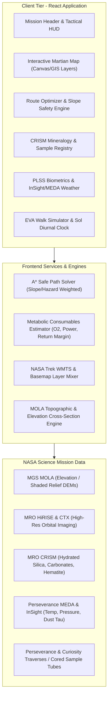

# Implementation Plan: Interplanetary Survival Guide - Martian Map (NASA Space Apps)

## Goal Description
Build a state-of-the-art, aerospace-grade **Martian Map & Marswalk Survival Guidance Frontend** in **React + Vite** for the NASA Space Apps Hackathon challenge: *"Interplanetary Survival Guide: Martian Map"*. 

The application synthesizes data from multiple NASA robotic missions (**MGS MOLA** topography, **MRO HiRISE/CTX** imagery, **CRISM** mineralogy, **Perseverance/Curiosity** rover traverses, and **InSight/MEDA** atmospheric stations) into a cohesive tactical operations cockpit. It empowers future Martian astronauts (EVA Field Ops) and Houston/JPL Mission Control to plan, simulate, and safely execute a Marswalk while maximizing scientific discoveries.

---

## System Design Alignment
Based on the architecture diagram provided in the hackathon submission:


---

## User Review Required

> [!IMPORTANT]
> **Layout & Design Direction**:
> The UI is structured as an **Aerospace Mission Control Cockpit** with dark glassmorphism (`backdrop-filter: blur()`), NASA mission badges, neon status telemetry (amber, cyan, emerald), and an interactive Martian surface canvas. Please review the layout schema below and approve to proceed with building.

> [!NOTE]
> **Zero External Heavy GIS Dependencies**:
> To guarantee lightning-fast performance, zero CORS breaking issues, and complete reliability during judging and offline demos, we implement a custom high-performance **Mars Surface GIS Canvas** supporting real NASA Mars Trek tile endpoints, pre-calibrated aerocentric coordinate transforms, multi-layer alpha blending (Viking, MOLA, CTX, CRISM, Slope Hazards), interactive vector waypoint routing, and elevation profile slicing.

---

## Application Layout Architecture

The cockpit layout follows a 4-quadrant tactical operations command grid:

```
+----------------------------------------------------------------------------------------------------+
|  [NASA Insignia] ARES-IV TACTICAL MARSWALK OPS   |  SOL 1240 14:32 LMST  |  EVA: NOMINAL  | [MODE] |
+----------------------------------------------------------------------------------------------------+
| [LEFT SIDEBAR] (340px)          | [CENTER: MARS MAP CANVAS]             | [RIGHT SIDEBAR] (380px)  |
| - Mission Selector              | - Multi-Layer Tile Renderer           | - Route Planning Engine  |
|   (Jezero / Gale / Valles)      |   (Viking, MOLA, CTX, CRISM, Hazards) | - Waypoint Sequence &    |
| - Layer Opacity Mixer           | - Interactive Reticle & Coordinates   |   POI Science Priorities |
|   * MOLA Elevation Color        | - Hazard Boundary Overlays (>15°)     | - Elevation Cross-Section|
|   * Slope Heatmap               | - Historical Rover & Astronaut Paths  |   Profile (SVG Chart)    |
|   * CRISM Minerals              | - Measurement Tool & North Compass    | - PLSS Consumables       |
| - Science Target Registry       | - Waypoint Placement & Inspection     |   * O2 Burn Rate         |
|   (Delta Front, Carbonates)     |                                       |   * Safe Return Radius   |
| - InSight / MEDA Weather        |                                       |   * Battery Endurance    |
+----------------------------------------------------------------------------------------------------+
| [BOTTOM HUD BAR]                                                                                   |
| Astronaut Telemetry: [Heart: 82 BPM] [Suit: 4.3 PSI] [O2: 84% - 5h 12m] | Active Alerts (0 Haz)    |
| [PLAY SIMULATION] [RESET ROUTE] [SAFE RETURN VECTOR] [EXPORT EVA MANIFEST] [VIEW SCIENCE CACHE]    |
+----------------------------------------------------------------------------------------------------+
```

### 1. Top HUD Bar (`MissionHeader`)
- **NASA Space Apps & Ares Mission Identity**: Official NASA insignia, mission identifier, and active field location.
- **Location Selector**: Fast switching between marquee exploration sites:
  1. **Jezero Crater** (Perseverance landing site, ancient river delta, crater rim, carbonate deposits).
  2. **Gale Crater & Mount Sharp** (Curiosity rover traverse, sulfate units, mudstones).
  3. **Valles Marineris** (Grand Canyon of Mars, extreme cliffs, layered sedimentary walls).
- **Martian Sol Clock**: Real Sol counter, Local Mean Solar Time (LMST), solar elevation angle, and day/twilight/night cycle indicator.
- **Communication Link Status**: Deep Space Network (DSN) uplink indicator with simulated light-speed delay (e.g. 14.2 min Earth-Mars latency).
- **Mode Toggle**: Astronaut Field HUD (compact high-contrast) vs Houston Flight Director (full telemetry suite).

### 2. Interactive Martian Map Canvas (`MartianMapCanvas`)
- **Multi-Mission Layer Compositor**:
  - **Base Layer**: NASA Viking Global Color Mosaic / High-res CTX Grayscale.
  - **MOLA Elevation**: False-color topographic relief highlighting crater rims, channels, and plains.
  - **Slope & Terrain Hazards**: Real-time slope gradient computation:
    - 🟢 *Safe (< 5°)*: Ideal EVA walking terrain.
    - 🟡 *Caution (5° - 15°)*: Moderate fatigue, increased oxygen consumption.
    - 🔴 *Hazard (> 15°)*: High slip risk, rover rollover threshold, impassable rock fields.
  - **CRISM Mineralogy**: Hydrated sulfates (cyan), carbonates (gold), olivine-rich basements (emerald), and subsurface water ice detections (blue).
  - **Mission POIs & Samples**: Cached sample tubes (Mars 2020), landing module (Hab), high-priority science outcroppings.
- **Interactive Controls**:
  - Pan, Zoom, Center on Hab, Center on Astronaut.
  - Interactive Waypoint Placing: Click to drop waypoints (WP-01, WP-02, Target Outcrop, Sample Site).
  - Inspect Tool: Real-time aerocentric lat/long readout, MOLA altitude (meters relative to Mars datum), slope gradient, and terrain trafficability.
  - Dynamic scale bar calibrated to Martian kilometers and meters.

### 3. Science & Layer Sidebar (`LayerAndScienceDeck`)
- **Tab 1: Mission Layers & Sensors**: Independent toggle switches and opacity sliders for MOLA, CTX, CRISM, and Slope Hazard maps with mission provenance details.
- **Tab 2: Science Target Registry**: Filterable catalog of geological landmarks with spectral profiles, astrobiological habitability ratings, and sample collection priorities.
- **Tab 3: Environmental Station (MEDA / InSight)**: Live atmospheric telemetry:
  - Surface Temperature (diurnal curve: -78°C to -12°C).
  - Atmospheric Pressure (720 Pa / 7.2 mbar).
  - Wind Velocity & Vector (e.g., 11.4 m/s from NW).
  - Dust Optical Depth ($\tau$ value, visibility range, dust devil warning).
  - Solar UV & Radiation Flux.

### 4. Route Planning & PLSS Deck (`MarswalkRoutePlanner`)
- **Tactical Route Solver**:
  - **Safest Route**: Minimizes steep gradients and rough terrain while maintaining life support safety margins.
  - **Direct/Fastest Route**: Shortest distance corridor with explicit hazard alerts on high-slope segments.
  - **Science Maximizer**: Automatically routes through high-value CRISM mineral outcrops and sample cache locations.
- **Elevation Cross-Section Chart**:
  - Dynamic SVG elevation profile of the active route showing ascent/descent peaks, slope angles at every waypoint, and danger zones (>15° highlighted in red).
- **PLSS Life-Support Consumables Estimator**:
  - Calculates real-time oxygen burn rate ($L/min$) scaled to astronaut metabolic exertion on uphill/downhill grades.
  - Battery consumption for suit thermal regulation.
  - **Safe Return Radius ("Point of No Return")**: Dynamic threshold indicating the maximum distance an astronaut can venture while retaining mandatory 45-minute emergency oxygen return reserves.
- **Export Flight Plan**: Download structured JSON / Print-ready Marswalk EVA manifest.

### 5. Tactical Telemetry & Simulation HUD (`BiometricAndMissionTelemetry`)
- **Astronaut Biometrics**: Heart rate monitor (BPM), suit internal pressure (4.3 PSI pure $O_2$), suit temperature, $CO_2$ scrubbing efficiency.
- **Live Marswalk Simulation**: Animate the astronaut moving along the planned route in real-time or accelerated time, dynamically draining consumables, detecting terrain changes, and logging science samples.
- **Hazard Warning Ribbon**: Audio-visual alert banner for slope excursions, sudden pressure drops, or rising dust optical depth.

---

## Directory & File Structure

Clean, modular, domain-driven structure adhering to modern React best practices:

```
Frontend/
├── public/
│   ├── favicon.svg
│   └── nasa-logo.svg
├── src/
│   ├── assets/
│   │   └── textures/
│   ├── components/
│   │   ├── common/
│   │   │   ├── Badge.jsx
│   │   │   ├── Button.jsx
│   │   │   ├── Card.jsx
│   │   │   ├── Modal.jsx
│   │   │   ├── Slider.jsx
│   │   │   ├── Tabs.jsx
│   │   │   └── Tooltip.jsx
│   │   ├── layout/
│   │   │   ├── MissionHeader.jsx
│   │   │   ├── MissionFooter.jsx
│   │   │   └── SidebarContainer.jsx
│   │   ├── map/
│   │   │   ├── MartianMapCanvas.jsx
│   │   │   ├── MapControls.jsx
│   │   │   ├── LayerSwitcher.jsx
│   │   │   ├── WaypointMarker.jsx
│   │   │   ├── MiniCompass.jsx
│   │   │   └── TerrainInspectTooltip.jsx
│   │   ├── route-planner/
│   │   │   ├── MarswalkRoutePlanner.jsx
│   │   │   ├── RouteOptimizerToggle.jsx
│   │   │   ├── WaypointManager.jsx
│   │   │   ├── ElevationProfileChart.jsx
│   │   │   └── PlssConsumablesDeck.jsx
│   │   ├── science/
│   │   │   ├── LayerAndScienceDeck.jsx
│   │   │   ├── CrismSpectralViewer.jsx
│   │   │   ├── SampleRegistry.jsx
│   │   │   └── SciencePoiDetailModal.jsx
│   │   ├── telemetry/
│   │   │   ├── BiometricsHud.jsx
│   │   │   ├── WeatherStationMeda.jsx
│   │   │   ├── HazardAlertBanner.jsx
│   │   │   └── MissionClock.jsx
│   │   └── simulation/
│   │       ├── MarswalkSimulatorControls.jsx
│   │       └── EvaManifestModal.jsx
│   ├── context/
│   │   ├── MapContext.jsx
│   │   ├── MissionContext.jsx
│   │   └── TelemetryContext.jsx
│   ├── data/
│   │   ├── missionsData.js
│   │   ├── layersData.js
│   │   ├── sciencePoisData.js
│   │   └── terrainElevationData.js
│   ├── hooks/
│   │   ├── useMarswalkSimulation.js
│   │   ├── useElevationProfile.js
│   │   └── useMedaWeather.js
│   ├── services/
│   │   ├── pathSolver.js
│   │   ├── plssCalculator.js
│   │   └── coordinates.js
│   ├── styles/
│   │   ├── index.css
│   │   ├── aerospace-theme.css
│   │   └── animations.css
│   ├── App.jsx
│   └── main.jsx
├── index.html
├── package.json
└── vite.config.js
```

---

## Verification Plan

### Automated Build & Lint Verification
1. Initialize Vite + React project with non-interactive flags:
   ```powershell
   npx.cmd -y create-vite@latest . --template react
   npm install lucide-react canvas-confetti
   ```
2. Run project build check:
   ```powershell
   npm run build
   ```
   Ensures zero syntax, type, or import errors.

### Interactive Functional Verification
1. **Launch Dev Server**:
   ```powershell
   npm run dev -- --port 5173 --host
   ```
2. **Subagent Browser Testing**:
   - Verify layout rendering on full desktop viewport (1920x1080 and 1440x900).
   - Test layer switching (MOLA elevation false color, CRISM minerals, slope hazard overlay).
   - Test waypoint creation by clicking on the Mars map surface.
   - Verify dynamic elevation profile recalculation on route modification.
   - Test PLSS life-support estimator (O2 burn, battery time, safe return margin).
   - Run the Marswalk walk simulation: verify astronaut moves along path, biometrics fluctuate realistically, and arrival at science checkpoints triggers sample collection events.
   - Test mission switching between Jezero Crater, Gale Crater, and Valles Marineris.
